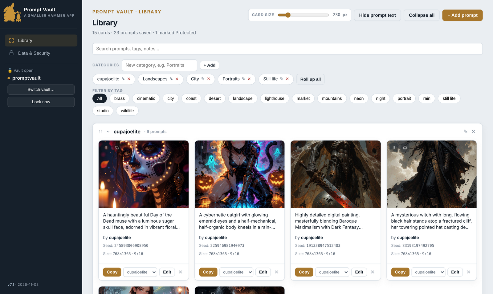
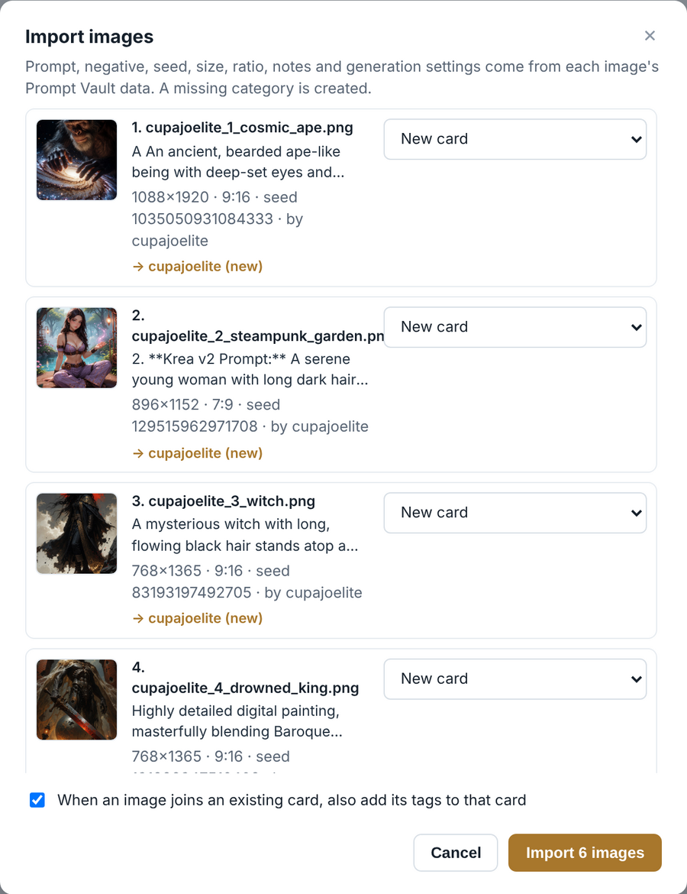

# Prompt Vault Desktop

A Windows desktop app for keeping the text prompts you write for image generators,
together with the picture each one produced, in one encrypted file on your own PC.

**v7.1 · build 2026-11-08** · A Smaller Hammer app. No account, no server, no internet
connection needed once it is built.



## Getting it running

You build the program once from these files; the result runs on any Windows 10 or 11 PC
without Python. The [user guide](docs/PromptVaultDesktop_UserGuide_v3.docx) walks through
every step with screenshots. In short:

1. Install **Python 3.10 or newer** from [python.org](https://www.python.org/downloads/).
   On the installer's first screen, tick **Add python.exe to PATH**.
2. On this page, click the green **Code** button, then **Download ZIP**. Extract it, for
   example to `C:\Dev`. You get a folder called `prompt-vault-desktop-main`.
3. Open that folder in File Explorer, click the address bar, type `cmd` and press Enter.
4. In the Command Prompt window that opens, run:

   ```
   py -m pip install -r requirements.txt
   build_exe.bat
   ```

5. Copy the finished folder `dist\PromptVault` somewhere permanent, such as
   `Documents\Prompt Vault`, and double-click `PromptVault.exe` inside it.

Windows may say *Windows protected your PC* the first time, because the program is not
signed. Click **More info**, then **Run anyway**.

To try it without building, double-click `run.bat` after step 4's first line. That runs
the app straight from these files, with a separate test vault in this folder.

## Features

- Prompts with a negative prompt, reference image, seed, size, ratio, tags and notes
- **Image import:** drop PNGs saved with the free
  [Prompt Vault Card nodes for ComfyUI](https://github.com/danger-uxb/comfyui-prompt-vault-card)
  onto the Library and each card fills itself in: prompt, negative, seed, size, ratio,
  model, LoRAs, sampler settings, category, tags and credit
- Generation settings and credit (prompt author, author URL, image source URL) kept with
  every prompt, and searchable
- Up to 10 variants per card: versions of one idea kept together, each with its own
  image, browsable on the card and in the image viewer
- Drag one card onto another to combine them, or pin a card and queue many into it at once
- Categories, search across every variant, tag filters, adjustable card size
- One-click copy of any prompt
- Several vaults, each with its own passphrase
- Encrypted and plain backups; import by merging or replacing; three automatic safety copies

## Try it with the sample images

The `samples` folder holds six PNGs saved with the Prompt Vault Card node. Unlock Prompt
Vault, select all six in File Explorer and drag them onto the Library: the review window
shows six new cards, ready to import, in a new **cupajoelite** category. The user guide's
*Try it: the sample images* chapter walks through it.



## Where your data lives

Everything is in one file, `promptvault.vault`, next to `PromptVault.exe`. It is encrypted
(AES-256-GCM) with your passphrase. **The passphrase is never stored and cannot be
recovered.** The whole program folder is portable: copy it to another PC or a USB stick
and it runs there.

The vault is the only copy of your prompts until you export a backup. **Export an
encrypted backup to a second drive regularly.**

To upgrade, build the new version and copy its `PromptVault.exe` and `_internal` folder
over the old ones. Your vault and settings are not touched.

## Files

| File | Purpose |
|---|---|
| `app.py`, `vault.py`, `ui\` | The application |
| `requirements.txt` | The tools to install before building |
| `build_exe.bat`, `promptvault.spec` | Build `dist\PromptVault\PromptVault.exe` |
| `run.bat` | Run from source without building |
| `docs\` | The user guide, and the screenshots on this page |
| `samples\` | Six example PNGs to try image import with |

## Credits

The example prompts in the user guide and the sample images are by
**[cupajoelite](https://civitai.com/user/cupajoelite)**, used with their permission. The
sample pictures were rendered from those prompts by Smaller Hammer; the originals are:

| Sample | Original |
|---|---|
| `cupajoelite_1_cosmic_ape.png` | https://civitai.com/images/147214871 |
| `cupajoelite_2_steampunk_garden.png` | https://civitai.com/images/148251721 |
| `cupajoelite_3_witch.png` | https://civitai.com/images/147215030 |
| `cupajoelite_4_drowned_king.png` | https://civitai.com/images/147190802 |
| `cupajoelite_5_neon_catgirl.png` | https://civitai.com/images/146770843 |
| `cupajoelite_6_day_of_the_dead.png` | https://civitai.com/images/147214831 |

The prompts and images remain cupajoelite's; the MIT licence below covers the software only.

## Licence

MIT — see [LICENSE](LICENSE). © 2026 Smaller Hammer.
